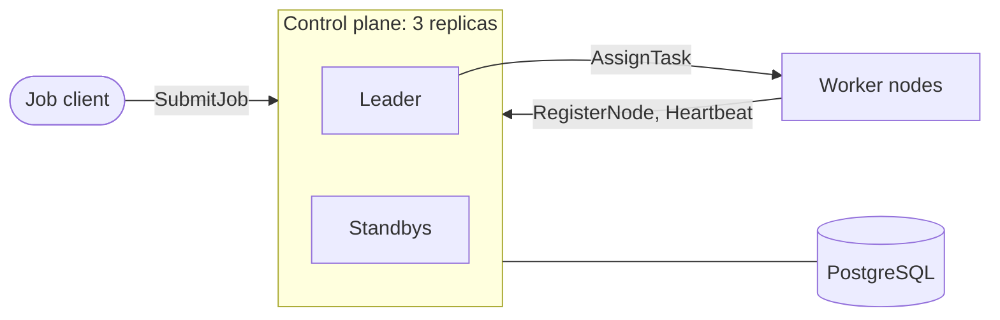

# Design

This file grows by one section per milestone. Each section covers what was built, why it was designed that way, the tradeoffs, and questions an interviewer might ask.

## Terms

- **Job:** what a client submits: a CPU and memory request plus how long the simulated task runs. Each job has exactly one task.
- **Node:** one worker process. It offers a fixed CPU and memory capacity and runs tasks.
- **Assignment:** one placement of a job's task on a node. If a node dies, its jobs get new assignments on other nodes, so a job can have several assignments over its life, but never more than one active at a time.
- **Leader:** the one control plane replica, out of three, that is allowed to make decisions (place tasks, declare nodes dead).
- **Epoch:** a number that goes up by one every time a new leader takes over. It is the fencing token that lets everyone reject messages from a replaced leader.

## Milestone 1: project setup, protobuf contract, PostgreSQL

### What was built

- A Gradle build (Kotlin DSL) with a version catalog in `gradle/libs.versions.toml`. The Java toolchain is pinned to 21, and the foojay resolver downloads JDK 21 if the machine does not have it.
- A `proto` module holding the wire contract in three files under `proto/src/main/proto/clusterscheduler/v1/`:
  - `resources.proto`: the `Resources` message (CPU in millicores, memory in MB).
  - `control_plane.proto`: the `ControlPlane` service (`RegisterNode`, `Heartbeat`, `SubmitJob`).
  - `worker.proto`: the `Worker` service (`AssignTask`).
- `docker-compose.yml` with PostgreSQL 18.6 and a health check, so `docker compose up --wait` returns only once the database accepts connections.

The `control-plane` and `worker` modules arrive in milestone 2 with their first code. Only the control plane will talk to PostgreSQL; the worker will depend on nothing but the `proto` module.

### Who calls whom

### Why it is designed this way

**Workers call in to report; the leader calls out to assign.** Workers dial the control plane to register and send heartbeats. The leader dials each worker's `AssignTask` to hand it a task. The other option was to return assignments inside heartbeat responses, so workers only ever dial out. I chose push for two reasons. First, a task starts as soon as it is placed instead of waiting up to one heartbeat interval. Second, the spec requires workers to reject assignments from an old leader. That check only means something if the worker receives the request directly from a replica that might be stale. With pull, any replica would read assignments from PostgreSQL, and the worker would have nothing to check.

**Any replica records facts; only the leader makes decisions.** `RegisterNode`, `Heartbeat` and `SubmitJob` only write down what happened (a node joined, a node is alive, a job arrived), so every replica serves them by writing to PostgreSQL. Placing tasks and declaring nodes dead are decisions, and only the leader makes them, in its own loops. As a result, leader failover never stops heartbeats or job submission, and healthy nodes are not declared dead just because the leader was down. It also keeps fencing simple: only the leader's writes need an epoch check.

**Each kind of ID is chosen by whoever can make it unique and safe to retry.**
- The client picks the `job_id`, so resubmitting the same job after a timeout creates one job, not two.
- Every registration gets a new `node_id`. A worker that restarts has lost its in-memory tasks, so it should not inherit its old identity and the tasks that came with it. Its old node times out and those tasks are rescheduled. (Changed in milestone 7: the worker now proposes the ID, a fresh UUID per registration, reused across retries of that registration, so a retried `RegisterNode` cannot create a second node. See that section.)
- The leader picks an `assignment_id` for every placement. Workers remember the IDs they have seen, so a repeated `AssignTask` is harmless.

**Heartbeats send the full state, not just changes.** Each heartbeat lists every assignment the worker is running. If one heartbeat is lost, the next one carries the same information, and the reconcile loop always compares against a complete picture. Finished assignments are the one change-based field. The worker keeps sending them until a heartbeat succeeds, and the control plane ignores repeats.

**`must_reregister` handles a node that comes back.** If a node goes quiet long enough to be marked dead, its tasks are moved elsewhere. If it then comes back (for example after a network outage) and sends a heartbeat, the response tells it to stop every task and register as a new node. Without this it would keep running tasks that now also run somewhere else.

**`leader_epoch` is the sender's epoch, not the epoch the assignment was created in.** A new leader may resend an assignment created by the previous leader, for example when the old leader died after saving it but before delivering it. The request carries the new leader's own epoch, which tells the worker that the sender is the current leader.

**Small details.**
- CPU is in millicores and memory in MB, as integers, so the scheduler's arithmetic is exact.
- protoc is pinned to 3.25.9 because that is the protobuf runtime version grpc-java 1.85 depends on. Generated code must not be newer than the runtime it runs on.
- PostgreSQL's port is bound to 127.0.0.1, because the credentials in the compose file are for local development only.

### Tradeoffs

- **Push needs the leader to reach every worker.** Each worker sends its address at registration. That is trivial inside one Docker network, but workers behind NAT or a firewall would need the pull model.
- **PostgreSQL takes every heartbeat write.** 100 nodes sending one heartbeat per second is about 100 small writes per second, which is nothing for PostgreSQL. At tens of thousands of nodes you would batch heartbeats or keep them out of the database.
- **PostgreSQL is the single source of truth and the coordinator.** That gives strongly consistent state and transactions with almost no code, and leader election can reuse it instead of adding etcd or ZooKeeper. The cost is that PostgreSQL itself is a single point of failure in this setup. If it is down, no replica can make progress, which is the safe outcome: no leader can act without it.
- **The whole contract is defined up front.** Some fields (`leader_epoch`, `must_reregister`) are only used from later milestones. Protobuf lets fields be added later without breaking anything, but writing the contract first made the design easier to review as a whole.

### Interview questions

**Why does the leader push assignments to workers instead of returning them in heartbeat responses?**
Pushing starts tasks immediately instead of waiting for the next heartbeat, and it makes the worker-side fencing check meaningful: the worker sees the sender's epoch and can refuse a stale leader. The cost is that the leader must be able to reach every worker, which pull would avoid.

**If only one replica is the leader, why can standbys handle heartbeats and job submissions?**
Those calls record facts, not decisions, and all state lives in PostgreSQL, so any replica can write them. This keeps heartbeats flowing during a failover, so the new leader does not wrongly declare healthy nodes dead because nobody was listening while there was no leader.

**Why does a restarted worker get a new node ID instead of keeping its old one?**
A restart wipes the worker's in-memory tasks. If it kept its ID, the control plane would believe the old tasks were still running there. With a fresh ID, the old node simply times out like any dead node and its tasks are rescheduled through the normal path, with no special case.

## Milestone 2: worker registration and heartbeats

### What was built

- **`control-plane` module.**
  - `Database` wraps a HikariCP connection pool and has one helper, `inTransaction`, which commits on success and rolls back on any exception.
  - `SchemaInitializer` applies `schema.sql` at startup.
  - `NodeRepository` inserts nodes and records heartbeats.
  - `ControlPlaneService` is the gRPC API. `ControlPlane` wires the pieces together, and `ControlPlaneMain` starts it from environment variables.
- **`worker` module.**
  - `ControlPlaneClient` calls the control plane and moves to the next replica when one fails.
  - `HeartbeatLoop` registers the worker and then sends a heartbeat every second.
  - `WorkerNode` wires it together, and `WorkerMain` starts it.
- **`NodeRegistrationTest`**, the first integration test. It runs a real control plane and a real worker against PostgreSQL in a Testcontainers container, and checks registration, heartbeats, and re-registration with a new ID when the control plane no longer knows the node.
- **One multi-stage `Dockerfile`** with two targets (`control-plane`, `worker`), plus compose services for one control plane and three workers (`--scale worker=N` for more).

### Why it is designed this way

**State is in PostgreSQL from the first milestone, not in memory first.** The design says all state lives in PostgreSQL, and the plan for any replica to accept heartbeats only works if the state is shared. An in-memory store would have been thrown away in milestone 4.

**Plain JDBC, no ORM.** Every SQL statement the system runs is visible in the repository classes. That matters later, because correctness depends on exactly which rows each statement locks and which conditions it checks. An ORM would hide that.

**The heartbeat timestamp is set by the database (`now()`), never by a replica.** Three replicas have three clocks. If replica A writes heartbeats with its clock and replica B checks them against its own, a few seconds of clock skew could make a healthy node look dead. Using one clock, PostgreSQL's, for both the write and the check removes the problem.

**Registration happens inside the heartbeat loop.** If the worker has no node ID, the next tick registers first. That gives retries for free: if no replica is reachable, the tick fails, gets logged, and the next tick tries again. When the control plane says `must_reregister`, the worker clears its ID and the same path registers it again.

**The scheduled task never throws.** `ScheduledExecutorService` silently cancels a repeating task the first time it throws. A worker would then stop heartbeating forever with nothing in the logs. `HeartbeatLoop` catches every runtime exception and logs it.

**The worker sticks to one replica.** It starts at a random replica, to spread load, and only moves to the next replica when a call fails with `UNAVAILABLE` or `DEADLINE_EXCEEDED`. Errors such as `INVALID_ARGUMENT` would fail on every replica, so it does not retry those.

**The schema is created at startup under an advisory lock.** Every replica runs `CREATE TABLE IF NOT EXISTS`, but two of those running at the same moment can still collide inside PostgreSQL. `pg_advisory_xact_lock` makes replicas take turns.

**`WorkerNode.close()` behaves like a crash.** It just stops, without telling the control plane. That is what the node failure tests need, and the system never relies on a clean goodbye anyway.

### Tradeoffs

- **No migration tool.** `schema.sql` describes the current schema, and every run starts from an empty database. A real deployment would need versioned migrations, for example with Flyway.
- **Every heartbeat is a database transaction.** That is simple and always consistent. At around a hundred nodes it is a negligible load; at many thousands you would batch heartbeats.
- **Blocking gRPC stubs.** One thread waits per call. The code is easier to follow than async callbacks, and the call rates here are low.
- **Sticky replica choice can be uneven.** Workers spread out randomly at start but do not rebalance. For writes that all end up in the same PostgreSQL, that is fine.

### Interview questions

**Why does the database set the heartbeat time instead of the replica that received it?**
Because the time is later compared against "now" to decide whether a node is dead, possibly by a different replica. Two clocks with skew between them could declare a live node dead. With `now()` in PostgreSQL, the write and the check use the same clock.

**What happens if the heartbeat code throws an exception?**
Without the catch, `ScheduledExecutorService` would cancel the repeating task and the worker would silently stop heartbeating. The control plane would then declare it dead even though the process is healthy. The loop catches and logs failures, so the next tick runs normally.

**Why do workers retry on another replica only for some errors?**
`UNAVAILABLE` and `DEADLINE_EXCEEDED` mean "this replica cannot answer right now", so another replica might succeed. `INVALID_ARGUMENT` means the request itself is wrong, and every replica would reject it the same way.

## Milestone 3: scheduler with bin packing

### What was built

- **Tables.**
  - `jobs` holds the desired state: `PENDING`, `SCHEDULED` or `FINISHED`. A partial index serves the pending queue in arrival order.
  - `assignments` holds every placement ever made: `ASSIGNED`, then `RUNNING`, then `FINISHED`. A partial unique index allows at most one active assignment per job.
- **`BestFitScheduler`**, a pure function that takes pending jobs and node free space and returns placements. It has its own unit tests.
- **`SchedulingLoop`**, which every 100 ms reads up to 1,000 pending jobs and every node's free space, asks the scheduler for placements, saves them, and hands them to `AssignmentSender`.
- **`AssignmentRepository.saveNew`**, which claims each job (`PENDING` to `SCHEDULED`) and inserts its assignment in the same transaction.
- **`AssignmentSender` and `WorkerChannels`**, which push `AssignTask` to workers from a pool of 16 threads.
- **Worker side.**
  - `TaskRunner` runs simulated tasks: each holds its CPU and memory for its duration.
  - `WorkerService` serves `AssignTask`.
  - `NodeIdentity` holds the current node ID.
  - Heartbeats now carry free space plus running and finished assignment IDs.
- **`HeartbeatRepository`**, which applies one heartbeat in one transaction: node alive, assignments now running, assignments and jobs finished.
- **Integration tests** (`SchedulingTest`): 12 jobs fill three nodes exactly with no overcommit; finished jobs free space for waiting ones; a job too big for any node waits without blocking smaller ones; a resubmitted job ID creates one job.

### Why it is designed this way

**Best fit, scored by leftover share.** For each job, in queue order, the scheduler picks the node with the least space left after placing it. "Least space" needs one number for two resources, so it adds the share of CPU left (leftover millicores / node CPU capacity) and the share of memory left. Shares make a millicore and a megabyte comparable. Best fit fills nearly full nodes first and keeps big gaps open for big jobs, which is what raises utilization. Worst fit, which spreads load, would leave many medium gaps that no large job fits.

**A job that fits nowhere is skipped, not waited on.** If the head of the queue is too big for every node, smaller jobs behind it still get placed. That keeps utilization high. The cost is that a very large job can wait a long time while small jobs keep taking the space it needs. Fixing that (reservations, aging) is beyond this project.

**Free space comes from the assignments table, not from heartbeats.** A heartbeat is up to one interval old. If the scheduler trusted reported free space, it would place a second wave of tasks on space it had just given away. Capacity minus the requests of active assignments is exact the moment a placement commits. Reported free space is still stored, for comparison.

**Save, then send.** The leader commits the assignment to PostgreSQL before calling the worker. If it crashes in between, the record exists and the next leader resends it (milestone 4). With the opposite order, a crash could leave a task running that the database knows nothing about, and the scheduler would happily place the job again.

**Claiming a job is a compare-and-set.** `UPDATE jobs SET state = 'SCHEDULED' WHERE job_id = ? AND state = 'PENDING'` only succeeds once per job, and an assignment is only inserted for a successful claim. The unique index on active assignments is a second, independent guard that PostgreSQL enforces no matter what the code does.

**All decisions run on one thread.** Scheduling (and, in milestone 4, declaring nodes dead) runs on a single thread per replica. Two decisions inside one replica can never interleave, so there are no locks to reason about between them.

**Finished reports are sent at least once and applied at most once.** The worker keeps a finished ID until a heartbeat carrying it succeeds. The control plane only finishes assignments that are still active on that node. Sending twice is harmless, and losing a heartbeat loses nothing.

**Workers remember every assignment ID, including finished ones.** A delayed duplicate `AssignTask` can arrive after the task finished. If the worker only remembered running tasks, it would run the task a second time.

**`AssignTaskRequest` carries the node ID.** Docker reuses IP addresses. If node A dies and a new worker B gets A's IP, the leader may still try to send A's assignment to that address. B checks the node ID, answers `RESULT_WRONG_NODE`, and does not start a task the database thinks is on A.

### Tradeoffs

- **One pass handles at most 1,000 jobs and costs jobs × nodes comparisons.** At 1,000 × 100 that is 100,000 cheap comparisons, well under a millisecond. Thousands of nodes would call for indexing nodes by free space.
- **The scheduler reads outside the write transaction.** The free space it sees can only be stale in the safe direction (a task finished and freed space), because the only thing that adds load is this same thread.
- **The dedupe set on workers grows forever.** It holds one string per assignment ever received, which is fine for a run of thousands of tasks. A long-lived worker would keep only recent IDs, for example everything newer than a timestamp.
- **Tasks are simulated.** Nothing actually uses the CPU. The scheduler's correctness does not depend on what a task does, and this way one laptop can run thousands of them.

### Interview questions

**How does best fit compare CPU with memory?**
It converts both to shares of the node's capacity and adds them: (CPU left / CPU capacity) + (memory left / memory capacity). The node with the smallest sum is the tightest fit. Without the conversion, memory in megabytes would dominate CPU in millicores just because the numbers are bigger.

**Why write the assignment to the database before sending it to the worker?**
The database is the source of truth. If the leader dies after writing, the next leader sees the assignment and delivers it. If it sent first and died before writing, a task would run without any record, the job would still look pending, and it would be placed a second time.

**How do you make sure a finished task is counted exactly once?**
Two halves. The worker resends a finished ID until a heartbeat succeeds (at least once). The control plane only finishes an assignment that is still active on that node, so a repeat matches no rows (at most once in effect). Together they act like exactly once without any distributed transaction.

## Milestone 4: reconcile loop and node failure handling

### What was built

- **Node status** (`ALIVE`, `DEAD`) and a `LOST` assignment state.
- **`NodeRepository.markExpiredNodesDead`.** In one transaction it marks every node with a heartbeat older than the timeout as `DEAD`, marks that node's active assignments `LOST`, and puts their jobs back to `PENDING`.
- **`AssignmentRepository.findUnconfirmed`**, which finds assignments still `ASSIGNED` (no heartbeat has confirmed them) after a grace period, on live nodes.
- **`ReconcileLoop`**, which runs every second on the decision thread. Each pass declares expired nodes dead, then resends unconfirmed assignments.
- **Heartbeats from a `DEAD` node** now get `must_reregister = true`. The worker clears its node ID, stops every task, and registers as a new node.
- **Defaults:** heartbeats every 1 s, a node is dead after 5 s of silence, reconcile every 1 s, resend after 3 s.
- **`NodeFailureTest`** covers three cases:
  - A crashed worker's tasks move to healthy nodes, and every job ends with exactly one active assignment.
  - A worker whose heartbeats arrive too late is declared dead, stops its task, and comes back as a new node while the job runs elsewhere.
  - An assignment that was saved but never sent (a leader dying between the two steps) gets delivered by the reconcile loop.

### Why it is designed this way

**The loop compares whole states instead of reacting to events.** Each pass asks "which live nodes have gone quiet?" and "which assignments has no one confirmed?" against the current tables. It never asks "what happened since last time?". A pass that is skipped (the replica was busy, or there was no leader) loses nothing, because the next pass sees the same facts. This is the Kubernetes controller pattern: level-triggered, not edge-triggered.

**Rescheduling just puts the job back in the queue.** The reconcile loop never picks a new node itself. It returns the job to `PENDING`, and the normal scheduling loop places it with best fit, like any other job. One code path places tasks, so there is one place to get placement right. Requeued jobs keep their original `submitted_at`, so they go to the front of the queue.

**Declaring a node dead and receiving its heartbeat cannot both win.** The heartbeat does `UPDATE nodes ... WHERE node_id = ? AND status = 'ALIVE'`. The leader does `UPDATE nodes SET status = 'DEAD' WHERE status = 'ALIVE' AND last_heartbeat_at < now() - timeout`. Both update the same row, so PostgreSQL makes one wait for the other. When the second one runs, PostgreSQL evaluates its `WHERE` clause again against the row the first one committed. Either the heartbeat landed first (the node is no longer expired and stays alive) or the node is already `DEAD` (the heartbeat matches nothing and the worker is told to register again). There is no in-between.

**Dead is permanent.** A `DEAD` node never becomes `ALIVE` again. A worker that comes back registers as a brand-new node. Otherwise the system would need a "dead but maybe still running things" state, and every query would have to reason about it.

**Only unconfirmed assignments are resent, and resending is harmless.** An assignment stays `ASSIGNED` until a heartbeat lists it. If that has not happened after 3 seconds, the send failed or never happened. Workers ignore an assignment ID they have already seen, so an unnecessary resend costs one RPC and changes nothing.

**Choosing the timeout is a tradeoff.** Five seconds is five missed heartbeats. A shorter timeout recovers faster but wrongly kills nodes during a GC pause or a network blip, and each false positive moves every task on that node. A longer timeout leaves tasks down for longer when a node really dies. Recovery time comes out to roughly the timeout plus up to one reconcile interval, one scheduling pass and one heartbeat to confirm. Milestone 7 measures it.

### Tradeoffs

- **A partitioned node keeps running its tasks until it can reach the control plane again.** The control plane is right to move them after 5 s, and the database never shows a job with two active assignments. But the cut-off worker does not know it has been declared dead until its next successful heartbeat, so for that window the task runs in two places. The standard fix is self-fencing: a worker that has gone longer than the timeout without a successful heartbeat stops its own tasks. It needs the worker's limit to be safely shorter than the control plane's, despite clock drift, so it is listed here as a known gap rather than built.
- **The timeout is a fixed number.** Adaptive failure detectors (phi accrual, as in Cassandra) adjust to observed heartbeat jitter. A fixed timeout is easier to explain and to test.
- **A running task that silently vanishes from a worker is not detected.** Heartbeats list running tasks, and a missing one could be treated as lost. In this design a worker only loses tasks by restarting, and a restart creates a new node ID, so the old node times out instead.

### Interview questions

**What if a heartbeat arrives at the exact moment the leader declares that node dead?**
Both are `UPDATE`s on the same `nodes` row with their condition in the `WHERE` clause. PostgreSQL's row lock serializes them and re-checks the condition for whichever goes second. Either the heartbeat wins and the node stays alive, or the node is already dead and the heartbeat is told to register again.

**Why does rescheduling put jobs back in the queue instead of moving them straight to a new node?**
So that only one piece of code decides placement. The scheduler already does best fit, checks capacity and claims jobs atomically. Duplicating that in the failure path would be a second place for bugs, and it would be a worse placement than what the scheduler does with up-to-date free space.

**A node is declared dead but was actually alive. What happens?**
Its jobs are already placed elsewhere. On its next heartbeat it gets `must_reregister`, stops all its tasks, and registers as a new, empty node. Until that heartbeat gets through, it may still be running those tasks; a self-fencing timeout on the worker would close that window.

## Milestone 5: leader election with leases

### What was built

- **A one-row `leader_lease` table** (`holder`, `epoch`, `expires_at`).
- **`LeaseRepository`.** `tryAcquire` takes the lease only if it has expired, and adds one to the epoch. `renew` extends it only for the same holder, the same epoch, and only while it is unexpired.
- **`Leadership`**, the replica's own view of its term, with a local deadline.
- **`LeaderElector`.** Every 500 ms the leader renews and a standby tries to acquire. The lease lasts 2 s.
- **Scheduling and reconcile run only while `Leadership` says this replica leads**, and every `AssignTask` carries the leader's epoch.
- **Compose runs three replicas** (`control-plane-1..3`). Workers get all three addresses.
- **Tests.** `LeaseRepositoryTest` covers acquire, renew and expiry. `LeadershipTest` covers the deadline with a fake clock. `LeaderFailoverTest` covers:
  - never more than one leader;
  - a crashed leader replaced by a higher epoch;
  - scheduling continues after failover with no job placed twice;
  - heartbeats still recorded while there is no leader.
- **A manual check in Docker:** killing the leader container gave a new leader about 1.9 s later.

### Why it is designed this way

**PostgreSQL as the lock service.** Raft, etcd or ZooKeeper would be the textbook choice, but they add a second consistent store to run and keep in sync. Here all state is already in PostgreSQL, and the leader is useless without it anyway. A single row updated with a conditional `UPDATE` is a linearizable compare-and-set, which is everything a lease needs. The availability of election equals the availability of the data, which is the right coupling.

**Acquire is one conditional statement.** `UPDATE leader_lease SET holder = me, epoch = epoch + 1, expires_at = now() + 2s WHERE expires_at <= now()`. If two standbys race, the row lock makes one wait. When it continues, PostgreSQL re-checks `expires_at <= now()` against the winner's row, which now expires in the future, so the second one updates nothing. There is no read-then-write gap to exploit.

**The epoch goes up on every change of holder, never on renewal.** It numbers terms. Renewing keeps the term, and taking over starts a new one. That is what lets an epoch serve as a fencing token in milestone 6.

**An expired lease is never renewed, even by its own holder.** If the lease expired, someone else may have taken it and given it back during that time, and the holder cannot tell. Going through `tryAcquire` again starts a new epoch, so "my lease expired" always means "my term is over".

**The leader also keeps its own deadline.** The database knows when the lease expires, but the leader cannot ask before every action. `Leadership` sets a local deadline of (time the renewal was sent) + 2 s, using `System.nanoTime`, which only moves forward. The database computes its expiry from when it ran the `UPDATE`, which is no earlier, so the local deadline always passes first. A leader that cannot reach the database stops scheduling on its own, without being told. This is about not wasting work. Milestone 6 makes correctness independent of it.

**A restarted replica starts from scratch.** After a crash and restart it does not know the epoch it held, so it cannot renew. It waits for the lease to expire and acquires a new term like anyone else.

**Lease duration 2 s, renew every 500 ms.** The leader can miss three renewals in a row (a slow query, a short GC pause) before it loses leadership. A standby notices an expired lease within one renew interval. Failover therefore takes 2 to 2.5 s after the leader dies. A shorter lease fails over faster but costs more writes, and a slow moment is more likely to lose the lease.

### Tradeoffs

- **Failover can never be faster than the lease.** A crashed leader is only detected by its lease running out. Ending a lease early on clean shutdown would speed up planned restarts, but crashes are what matter here.
- **PostgreSQL is still a single point of failure.** If it is down, no one can lead, and nothing else can happen either. A highly available PostgreSQL (streaming replication with failover) would be the next step in production.
- **Time-based leases cannot stop a paused leader.** A leader frozen by a long GC pause or a stopped container still believes it leads when it wakes up, until its local deadline check runs. Between the check and the write, it could act on an expired term. This is exactly the gap fencing tokens close in milestone 6.
- **A full cold start could misjudge heartbeats.** If every replica is down for longer than the heartbeat timeout, heartbeats stop landing, and the first new leader would see every node overdue. Workers would re-register and lose their tasks. With three replicas, the chance of all being down at once is what this design accepts.

### Interview questions

**Why use a PostgreSQL row for leader election instead of etcd or ZooKeeper?**
The only thing election needs is an atomic compare-and-set with an expiry, and a conditional `UPDATE` on one row is exactly that. The leader cannot do anything without PostgreSQL anyway, so a separate coordination service would add operational load without adding availability.

**Two standbys see the expired lease at the same moment. What happens?**
Both send the conditional `UPDATE`. PostgreSQL locks the row for the first, and the second waits. When the second continues, its `WHERE expires_at <= now()` is re-evaluated against the new row, which now expires in the future, so it updates nothing and gets no epoch.

**If the database knows when the lease expires, why does the leader keep its own deadline?**
So it can stop acting without a database round trip, for example when it cannot reach the database at all. The deadline is measured from when the renewal was sent, so it always ends before the database's expiry. It is an optimization. The safety guarantee comes from the epoch check on every write.

## Milestone 6: fencing tokens and idempotent assignments

### What was built

- **Every assignment row records the `epoch`** of the leader that wrote it.
- **`FencedTransactions.run(epoch, work)`.** It starts each leader transaction with `SELECT epoch FROM leader_lease FOR SHARE`. If the epoch has moved on, it throws `StaleEpochException` and nothing is written.
- **The scheduler's saves and the reconcile loop's "declare dead and requeue" writes are fenced.** When a write is rejected, the replica steps down immediately and logs a `FENCED:` line.
- **Two timeouts.** PostgreSQL ends any session that sits idle inside a transaction for 2 s (`idle_in_transaction_session_timeout`). Lease writes give up after waiting 500 ms for a lock (`lock_timeout`).
- **Worker side.** `EpochFence` remembers the highest epoch seen. `WorkerService` checks, in one synchronized step: epoch first, then node ID, then assignment ID dedupe. A `RESULT_STALE_EPOCH` reply makes the sending replica step down too.
- **Tests.**
  - `FencedTransactionsTest`: a replaced leader cannot write; an expired but not yet replaced leader can; a takeover waits for an in-flight fenced transaction to commit.
  - `EpochFenceTest` and `WorkerServiceTest`: started, duplicate, stale epoch, wrong node, between registrations.
  - A new `LeaderFailoverTest` case: after a real failover, a worker refuses an `AssignTask` carrying the old leader's epoch.

### Why it is designed this way

**Leases alone are not enough.** A lease says "you lead until time T", but a process cannot always tell what time it is. Here is the classic failure:

1. The leader checks its lease. It is valid.
2. The leader freezes: a long GC pause, `docker pause`, a VM migration.
3. The lease expires, a standby takes over and starts epoch N+1, and it moves some work around.
4. The old leader wakes up and finishes the write it had started, based on what it read before the pause.

No amount of checking the clock fixes step 4, because the check in step 1 was correct when it happened. The fix (Kleppmann's fencing tokens) is to make whatever stores the write reject it. Every write carries the writer's term number, and storage refuses any term older than the newest it knows.

**The epoch check and the write must be atomic.** A plain `SELECT epoch` followed by the writes would leave a gap: the takeover could commit between the check and the commit. `FOR SHARE` closes the gap. The lease row stays share-locked until the fenced transaction ends, and a takeover is an `UPDATE` of that row, which needs a conflicting lock. So the takeover waits. Terms therefore never overlap in the database. Every epoch-N write either commits before epoch N+1 starts (and the new leader sees it) or is rejected.

**Safety depends on the epoch, never on the clock.** If the lease has expired but nobody has taken over, the old leader's fenced writes still succeed, and that is safe: no other term exists to conflict with. Time decides when a new leader may start (liveness). The epoch decides whose writes count (safety). The local deadline from milestone 5 is just there to avoid doing work that would be rejected.

**Only decisions are fenced.** Placing tasks and declaring nodes dead are decisions; they depend on the leader's view of the world. Heartbeats, registrations and job submissions are facts reported from outside. They are true no matter who leads, so any replica records them without a fence, and they keep flowing during failover.

**A frozen leader must not block a takeover forever.** If a leader freezes in the middle of a fenced transaction, it is holding the shared lock on the lease row. No standby could take over until it woke up. `idle_in_transaction_session_timeout = 2s` makes PostgreSQL end that session and release the lock. The 500 ms `lock_timeout` on lease writes means a standby's election thread gives up and retries on its next tick instead of hanging.

**Workers check the epoch too.** Sending `AssignTask` is not a database write, so PostgreSQL cannot fence it. A leader can commit an assignment, freeze, and send it after a new leader has taken over. Once a worker has seen epoch N+1, it refuses anything from an older epoch. That is the "every resource checks the token" rule. The check, the node ID check and the start all happen under one lock. Otherwise an old-epoch request could pass the check a moment before a newer request raises the epoch, and start after it.

**Assignments are idempotent by ID.** The same `AssignTask` can arrive several times: a retry after a timeout, a resend from the reconcile loop, or a new leader resending what the old one saved. The worker keeps every assignment ID it has accepted, so a repeat answers `RESULT_DUPLICATE` and starts nothing.

**Defense in depth.** "A task is never placed on two nodes" rests on several independent layers. Any one of them alone would stop most mistakes:
1. One decision thread per replica, so a leader never races itself.
2. A job is claimed with `UPDATE ... WHERE state = 'PENDING'`, so it can only be claimed once.
3. A unique index on active assignments per job, enforced by PostgreSQL no matter what the code does.
4. Fenced transactions, so a replaced leader's decisions never commit.
5. The worker epoch check, so a replaced leader's messages are refused.
6. Worker dedupe by assignment ID, so repeated deliveries are harmless.
7. The worker node ID check, so a reused IP address does not receive another node's task.

### Tradeoffs

- **Every leader write takes a shared lock on one row.** Shared locks do not block each other, but a lease renewal (an `UPDATE` of that row) waits for in-flight fenced transactions. Those last milliseconds, so renewals are not affected. With long transactions the lease could expire while waiting, which is a reason to keep leader transactions short.
- **A worker only learns new epochs from `AssignTask`.** A worker that has not yet heard from the new leader would accept a delayed message from the old one. That message describes an assignment committed under a fence, so it was legitimate when sent. The worker check matters once the new leader has been in touch, which is when old messages could do harm.
- **The idle timeout would also kill a legitimately slow client transaction.** No transaction here waits on anything between statements, so 2 s of silence only ever means the client is frozen.

### Interview questions

**Why are leases not enough for leader election on their own?**
Because a leader can pause right after checking its lease and resume after another leader has taken over, without knowing any time passed. Its check was correct when it ran. Only the storage, at write time, can tell that a newer term exists, so every write carries the writer's epoch and storage rejects older ones.

**Why `SELECT ... FOR SHARE` instead of a plain `SELECT` to check the epoch?**
A plain read checks the epoch at one instant, and the takeover can commit right after it, before our writes commit. `FOR SHARE` holds a lock on the lease row until our transaction ends. The takeover's `UPDATE` must wait for it, so the check stays true until we commit.

**If PostgreSQL already rejects writes from a stale leader, why do workers check epochs too?**
The `AssignTask` RPC happens after the database transaction, outside it. A stale leader can commit while still current, freeze, and send the RPC much later. The worker is a separate resource, so it has to check the token itself.

## Milestone 7: chaos test, node failure test, packing benchmark

### What was built

- **An `experiments` module.** Each experiment is a plain Java program that starts a fresh cluster with Docker Compose, breaks it on purpose, measures what happens, writes `results/NAME.json`, and tears the cluster down. One Gradle task per experiment: `failoverChaos`, `nodeFailure`, `packing`.
  - `FailoverChaosExperiment` takes the leader down 200 times while jobs keep arriving, alternating SIGKILL and `docker pause`, then counts double placements.
  - `NodeFailureExperiment` kills the busiest worker container five times and times how long until all its tasks run elsewhere.
  - `PackingBenchmark` submits 10,000 seeded jobs to 100 nodes and samples CPU utilization every second.
- **Supporting pieces.**
  - `DockerCompose` runs docker commands.
  - `ClusterDatabase` reads PostgreSQL directly, including the overlap check on assignment history.
  - `JobClient` and `JobStream` submit jobs.
  - `Stats` computes median, p99 and max.
  - `ResultsFile` writes the JSON.
- **An execution log on every worker.** It is an append-only JSON-lines file of what the worker started, finished, stopped or rejected. `WorkerLogCheck` reads all of them and finds any job that ran on two nodes at overlapping times. It has unit tests with synthetic logs, showing it does detect double runs, so a result of 0 means something.
- **Worker containers get a small heap and few threads** (`-Xmx24m`, serial GC, two Netty event loop threads), so 100 of them fit on a laptop. As a fallback for smaller machines, a worker process can also run several independent nodes (`NODES_PER_PROCESS`). The published results do not use it.
- **The replicas' gRPC ports are published on localhost** (9091 to 9093), so experiments and grpcurl can submit jobs.

### Why it is designed this way

**Kills and pauses, not just kills.** A killed process never writes again, so killing the leader only tests failover. Freezing it with `docker pause` and unfreezing it after a standby has taken over is the scenario fencing exists for: the old leader resumes believing it might still lead. Alternating the two gives 100 of each.

**Two independent sources for "double placement".** The database check reads the assignment history: did any job have two assignments active at overlapping times? It would be impossible to fail if the unique index were the only thing being tested, so a second source checks what actually happened. Workers log every task they really started and stopped, and the checker looks for a job running on two nodes at once. That would catch a task started without a record, or a duplicate delivery that slipped past dedupe.

**The checker is tested to fail.** A zero only means something if the check could have found a problem. `WorkerLogCheckTest` feeds it overlapping runs on two nodes, a never-finished run, and duplicate starts, and asserts it reports each one.

**The experiment counts which safety mechanism fired.** For the chaos run, the results record how many writes PostgreSQL rejected for a stale epoch (`FENCED:` log lines), how many frozen sessions PostgreSQL ended for the idle-in-transaction timeout, and how many assignments workers rejected for a stale epoch. A paused leader is only caught in the act if the pause lands inside a scheduling pass or between saving and sending, so these counts show how often the race actually happened rather than assuming it did.

**Utilization is only counted while jobs are waiting.** At the start the queue fills and at the end it drains. In both phases idle CPU says nothing about packing. A sample counts only if at least one job was pending, because then the scheduler had work it could have placed, and any unused CPU is space it could not fill. Allocated CPU is the sum of the requests of `ASSIGNED` and `RUNNING` assignments. The CPU the workers themselves report as used is recorded next to it for comparison.

**Results files first, README second.** Every experiment writes JSON. `ReadmeResults` (milestone 8) turns those files into the README table and fails if a field is missing, so a renamed field cannot quietly appear as a zero.

**100 real containers, small heaps first.** The spec allowed simulating several nodes per container if 100 JVM containers were too heavy, but only after trying small heaps. With the flags above, each worker container's memory, recorded by the benchmark with `docker stats`, was small enough for all 100 to fit in Docker's VM alongside the control plane and PostgreSQL. It was tight, and the VM used swap. `NODES_PER_PROCESS` stays as an option for smaller machines.

**The benchmark found a real bug.** The first 100-container run reported one node declared dead, in a run that kills nothing. All 100 workers had run to the end under a single node ID, and total capacity in every sample was exactly 100 nodes. So the dead node was an extra registration. With 100 JVMs starting at once, a `RegisterNode` call hit its 1-second deadline after the replica had already inserted the row. The worker retried and got a second node, and the first one never heartbeated. Nothing unsafe happened: anything the leader sent to the orphan carried its node ID, and the worker rejected it with `RESULT_WRONG_NODE`. The fix was to make registration idempotent, the same way job submission is. The worker picks a random registration ID, reuses it across retries, and the control plane inserts it with `ON CONFLICT DO NOTHING`. Every result in the README comes from runs after the fix.

**Why allocated CPU reads above what workers report.** Allocated CPU counts a task from the moment the leader saves it until a heartbeat reports it finished. Workers report what they run as of their last heartbeat. A task that has just been placed, or has just finished, is in one figure but not yet the other, so the worker figure lags. Both are in `packing.json`. Utilization uses the allocated figure, because that is what the scheduler decided and what the spec defines.

### Tradeoffs

- **Experiments run against one laptop.** Every container shares 10 cores and one Docker VM, so absolute times include that contention. Ratios and the correctness counts transfer better than raw milliseconds.
- **Times are measured from the host, by polling every 50 ms.** Failover time runs from when Docker reports the fault in place, so it slightly undercounts the time since the process actually died, and polling adds up to 50 ms.
- **The chaos run only takes down control plane replicas.** Node deaths are tested separately, so a job moving between nodes during the chaos run would itself be a red flag. The results report how many nodes were declared dead during it.
- **Pauses catch the leader mid-write only by chance.** The experiment does not inject artificial delays into the control plane to widen the race window. The fencing logic is tested directly by `FencedTransactionsTest` and the worker tests, and the chaos counts show how often the real race occurred.

### Interview questions

**How do you know your chaos test could catch a double placement?**
The checker that reads worker logs has unit tests that feed it a job running on two nodes at once and assert it reports it. Separately, the database check is a plain SQL query over the assignment history, which anyone can rerun. Both are independent of the code that does the placing.

**Why pause the leader instead of only killing it?**
A killed process can never send a stale write, so killing only tests that a standby takes over. A paused process wakes up later with stale beliefs, and that is the case where a missing fence would cause a double placement.

**Why count utilization only while jobs are waiting?**
If nothing is waiting, low utilization just means low demand. When jobs are queued, any CPU left unallocated is space the scheduler could not use, often because what is left on each node is too small for any waiting job. That is the quantity bin packing is supposed to minimize.
