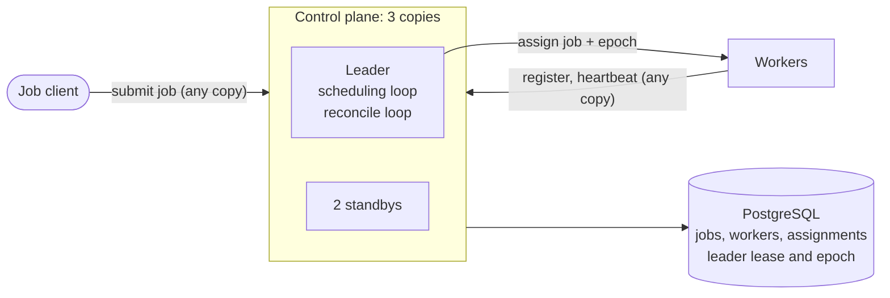

<div align="center">


# cluster-scheduler

**A job scheduler that packs work tightly onto a group of computers, and never places a job on two of them, even when its leader crashes.**

[](control-plane/build.gradle.kts)
[](proto/src/main/proto/clusterscheduler/v1)
[](control-plane/src/main/resources/schema.sql)
[](docker-compose.yml)
[](control-plane/src/test/java/clusterscheduler/controlplane)
[](control-plane/src/main/java/clusterscheduler/controlplane/metrics/Metrics.java)
[](LICENSE)

<a href="#what-it-does">✨ What it does</a> • <a href="#how-it-works">🔬 How it works</a> • <a href="#results">📊 Results</a> • <a href="#run-it">⚡️ Run it</a> • <a href="#things-i-learned">💡 Things I learned</a>

</div>

<a name="what-it-does"></a>
## ✨ What it does

- **Packs jobs tightly.** Each job asks for some CPU and memory. It goes on the worker computer where it fits most snugly, which keeps big gaps free for big jobs.
- **Moves jobs off dead computers.** Workers check in every second. One that goes quiet for 5 seconds is declared dead, and its jobs go to healthy workers.
- **Keeps going when the leader crashes.** Three copies of the control plane run at once. One is the leader, and if it crashes or freezes, another takes over once its 2-second lease runs out.
- **Never places a job on two computers.** A leader that froze can wake up after it was replaced, still thinking it leads. PostgreSQL and the workers both refuse anything it sends.

All the state lives in PostgreSQL, and leader election is a single row there, so there's no separate service like etcd or ZooKeeper.

<a name="how-it-works"></a>
## 🔬 How it works

Clients send jobs to any of the three control planes, which save them in PostgreSQL. Workers report in the same way, so jobs and heartbeats keep arriving even while there is no leader.

Whichever control plane holds a lease row in PostgreSQL is the leader, and only the leader makes decisions. It saves each decision first, then tells the worker over gRPC. A reconcile loop, the pattern Kubernetes uses, checks every second for workers that have gone quiet and for jobs no worker has confirmed, and fixes what it finds.

Every time the lease changes hands, a number called the epoch goes up by one. The leader's writes only commit if its epoch is still the current one, and workers refuse any epoch older than the newest they've seen. So a leader that has been replaced can't change anything, even if it doesn't know yet.



One known gap: a worker cut off from the network keeps running its jobs until it reconnects and learns they were moved, so for that time a job can be running in two places. This and the other [known limits](DESIGN.md#known-limits) are in the design notes.

More detail, and the choices I made: [DESIGN.md](DESIGN.md).

<a name="results"></a>
## 📊 Results

Each test runs the real system in Docker on my laptop (a MacBook with 10 cores) and breaks it on purpose. All numbers come from the files in [`results/`](results/).

- **Leader crash test:** takes the leader down 200 times while jobs keep arriving, half by killing it and half by freezing it. Then it looks for any job on two workers at once in two separate places: the database's history, and the logs workers keep of what they actually ran.
- **Worker crash test:** kills the busiest worker and times how long until all its jobs run on other workers.
- **Packing test:** sends 10,000 jobs of mixed sizes to 100 workers at once. Utilization means allocated CPU / total CPU capacity. It only counts while jobs were waiting, because then any unused CPU is space the scheduler couldn't fill.

<!-- results:begin (generated by `make results` from results/*.json; do not edit by hand) -->

**Leader crash test**

| | Result |
|---|---|
| Times the leader was taken down | 200 (100 killed, 100 frozen) |
| Jobs on two workers at once, from the database's history | **0** |
| Jobs that ran on two workers at once, from the workers' logs | **0** |
| Jobs ever given to a second worker | 0 |
| Assignments started twice | 0 |
| Jobs submitted during the test, and how many finished | 15,098 and 15,098 |
| Healthy workers wrongly declared dead | 0 |
| Time to get a new leader | 1,769 ms typical, 2,449 ms slowest |
| Writes from an old leader that the database refused | 1 |
| Frozen leaders' sessions that PostgreSQL ended | 0 |
| Assignments from an old leader that workers refused | 0 |

**Worker crash test**

| | Result |
|---|---|
| Workers killed | 5, each running 8 jobs |
| Time until all its jobs ran on other workers | 5,351 ms typical, 5,664 ms slowest |
| Time until it was declared dead | 4,964 ms typical, 5,124 ms slowest |
| Jobs on two workers at once, from the database's history | **0** |

**Packing test**

| | Result |
|---|---|
| Jobs and workers | 10,000 jobs on 100 workers, in 100 containers |
| CPU utilization while jobs were waiting | **97.5%** average, 90.4% lowest |
| CPU the workers themselves reported using | 91.0% average |
| Memory utilization while jobs were waiting | 92.3% average |
| Time to finish every job | 388 s (25.8 jobs per second) |
| Time for one round of scheduling decisions | 5.4 ms average |
| Memory per worker container | 41 MiB average, 46 MiB highest |
| Healthy workers wrongly declared dead | 0 |

<!-- results:end -->

The check that reads the workers' logs has its own [tests](experiments/src/test/java/clusterscheduler/experiments/WorkerLogCheckTest.java) showing it catches a job on two workers, so a 0 means something. A freeze only makes the database refuse a write if it lands in the middle of one, which is rare, so [another test](control-plane/src/test/java/clusterscheduler/controlplane/leadership/FencedTransactionsTest.java) covers that case directly. [How each number is measured](DESIGN.md#how-each-number-is-measured) is in the design notes.

<a name="run-it"></a>
## ⚡️ Run it

With Docker and Java 17 or later installed:

```bash
make cluster-up       # start 3 control planes, PostgreSQL and 5 workers
make jobs             # submit 12 jobs
make cluster-status   # see who leads and how the jobs are packed
make kill-leader      # crash the leader; a standby takes over
make kill-worker      # crash the busiest worker; its jobs move
make cluster-down     # stop it and delete its data
```

To run the tests:

```bash
make test             # unit and integration tests
make chaos            # leader crash test
make node-failure     # worker crash test
make packing          # packing test
make results          # rebuild the tables above from results/
```

The packing test's 100 containers use nearly all of the 8 GB I give Docker. On a smaller machine, `WORKER_CONTAINERS=50 NODES_PER_CONTAINER=2 make packing` runs 100 workers in half the containers.

<a name="things-i-learned"></a>
## 💡 Things I learned

- **Save the logs from a failed run.** The first 100-worker packing run reported one dead worker in a test that kills nothing, and my script had already deleted the containers and their logs. The evidence points to a registration whose reply timed out and was retried, which left a second copy of the worker that never checked in. I made registration safe to retry and the next run was clean, but I can't prove that was the cause.
- **Killing a process doesn't test fencing.** A killed leader can never send a late write, so killing it only tests that a standby takes over. The test also has to freeze the leader and let it wake up after it has been replaced.
- **A container costs more than the program inside it.** `docker stats` showed each worker was small, yet 100 of them nearly filled Docker's memory. Docker runs its own helper process for each container, and those add up.

## 📄 License

[MIT](LICENSE)
