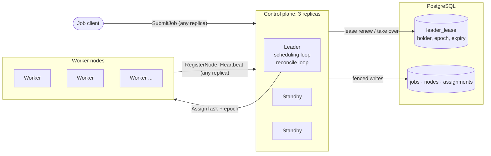

# cluster-scheduler

**A distributed cluster scheduler in Java: a leader-elected control plane packs jobs onto worker nodes, keeps the cluster in its desired state, and uses fencing tokens so a task is never placed on two nodes, even during failover.**

## What I built

Clients submit jobs, each with a CPU and memory request. Three control plane replicas share all their state through PostgreSQL. One of them leads at a time, chosen by a lease in the database, and only the leader makes decisions: it packs pending jobs onto worker nodes with best-fit bin packing and pushes each placement to its worker over gRPC. A Kubernetes-style reconcile loop compares desired state (the jobs table) with actual state (assignments plus heartbeats). When a node goes quiet it is declared dead, and its jobs go back in the queue to be placed elsewhere.

The hard part is failover. A leader that freezes (a long GC pause, a stopped container) can wake up after a standby has taken over, still believing it leads. Every leader term has an epoch number that serves as a fencing token. PostgreSQL rejects writes from an old epoch, and workers reject assignments from an old epoch, so a replaced leader cannot change anything.

- **Correctness tested under failure.** A chaos experiment takes the leader down 200 times, alternating SIGKILL and freezing the container, while jobs keep arriving. It then counts double placements in two independent places: the assignment history in PostgreSQL, and the execution logs the workers wrote about what they actually ran.
- **Failure recovery measured.** An experiment kills worker containers and times how long until every task that was on them runs on another node.
- **Packing measured.** A benchmark submits 10,000 mixed-size jobs to 100 nodes and samples CPU utilization (allocated CPU / total CPU capacity) every second.
- **Every number is generated.** The experiments write `results/*.json`, and the [results table](#results) below is rebuilt from those files by a program. None of it is typed by hand.

**Tech:** Java 21, Gradle, gRPC and Protocol Buffers, PostgreSQL 18 (plain JDBC with HikariCP), Docker Compose, JUnit 5 and Testcontainers, Micrometer with a Prometheus endpoint.

## Architecture



- **Any replica accepts facts.** Job submissions, registrations and heartbeats are written to PostgreSQL by whichever replica receives them. That keeps them flowing while there is no leader, so a failover never makes healthy nodes look dead.
- **Only the leader makes decisions,** on a single thread: placing jobs and declaring nodes dead. Each decision commits in a transaction that first locks the lease row and checks the epoch.
- **The leader pushes assignments** to workers over gRPC, stamped with its epoch. A worker refuses an epoch older than one it has seen, an assignment meant for another node ID, and an assignment ID it has already handled.

A job's life, from submission to completion:

```mermaid
sequenceDiagram
    participant C as Client
    participant R as Any replica
    participant DB as PostgreSQL
    participant L as Leader
    participant W as Worker

    C->>R: SubmitJob(job_id, cpu, memory)
    R->>DB: INSERT job (PENDING), idempotent on job_id
    loop every 100 ms
        L->>DB: read pending jobs and free space per node
        L->>L: best fit: tightest node that has room
        L->>DB: BEGIN; check epoch FOR SHARE; job PENDING to SCHEDULED; insert assignment; COMMIT
        L->>W: AssignTask(assignment_id, node_id, epoch)
        W->>W: check epoch, node ID, dedupe; start task
    end
    loop every second
        W->>R: Heartbeat(free space, running IDs, finished IDs)
        R->>DB: assignment RUNNING / FINISHED, job FINISHED
    end
```

[DESIGN.md](DESIGN.md) explains every part milestone by milestone: what was built, why, the tradeoffs, and the questions an interviewer might ask.

## License

MIT
